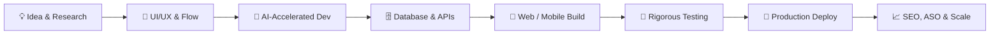

<h1 align="center">👋 Hi, I'm Tarun Mankar</h1>

<p align="center">
  <b>Independent Full-Stack Developer &nbsp;·&nbsp; AI Product Builder &nbsp;·&nbsp; Founder @ Tarun Music</b>
</p>

<p align="center">
  
</p>

<p align="center">
  <a href="https://tarunmankar.github.io"></a>&nbsp;
  <a href="https://www.linkedin.com/in/tarun-mankar/"></a>&nbsp;
  <a href="https://www.youtube.com/@tarun_mankar"></a>&nbsp;
  <a href="https://play.google.com/store/apps/dev?id=5447961862962854741"></a>&nbsp;
  <a href="https://www.tarunmusic.co.in"></a>
</p>

---

## 🚀 About Me

I am an **Independent Software Developer, AI Product Builder, and Digital Creator** based in India. I bridge software engineering with state-of-the-art Generative AI to design, build, deploy, and scale complete digital products end-to-end — from conception to production.

Rather than treating AI as an afterthought, I use AI as an integral force multiplier across the entire development and creative lifecycle: shipping full-stack SaaS, cross-platform mobile apps, cinematic music catalogs, and published literature solo.

```txt
🌐  Web Ecosystem     →  Creator of 9+ live platforms (News, Health, Govt Alerts, Fintech)
📱  Mobile Apps       →  Published 6+ Android utility & entertainment apps on Google Play
🎵  Tarun Music       →  Founder & Composer — 646+ licensed cinematic & commercial tracks
📖  Author & Narrator →  Mindset & somatic health literature on Somatic Library
🎬  AI Video Studio   →  Documentaries, concept trailers, and visual storytelling on YouTube
⚡  Core Philosophy   →  "I don't just write code — I build, launch, and scale complete products."
```

---

## 🛠 Tech Stack

<p align="center">
  
</p>

<details>
<summary><b>📂 Click to View Full Architecture & Toolkit Breakdown</b></summary>
<br>

| Layer | Tools & Technologies |
|:--|:--|
| **Frontend** | Next.js (App Router) · React · React Native · TypeScript · JavaScript (ES6+) · Tailwind CSS · HTML5 / Modern CSS |
| **Backend & APIs** | Node.js · Next.js Server Actions · RESTful APIs · JWT Auth · Webhooks · Serverless Functions |
| **Databases** | PostgreSQL · Supabase · Firebase Firestore · Firebase Realtime DB · Neon DB · SQLite |
| **Cloud & Hosting** | Vercel · Firebase Hosting · Cloudflare CDN & R2 · AWS S3 · GitHub Pages · Custom Domains & SSL |
| **AI & Automation** | AntiGravity IDE · Cursor AI · ElevenLabs (Audio/Voice) · OpenAI · Claude · Google Gemini · Copilot |
| **DevOps & CI/CD** | Git · GitHub Actions · Automated Deployments · Environment Configuration · Performance Optimization |

</details>

---

## 🌐 Live Web Platforms I've Built & Manage

| # | Platform | Focus & Impact | Live Link |
|:--:|:--|:--|:--:|
| 🎵 | **Tarun Music** | Commercial sync licensing & cinematic score catalog with 646+ tracks | [Visit Site ↗](https://www.tarunmusic.co.in/) |
| 📰 | **Jordar Khabar** | Fast, high-traffic Hindi news portal for national and local breaking stories | [Visit Site ↗](https://www.jordarkhabar.in/) |
| 🧘 | **Somatic Library** | Mind-body wellness portal offering guided somatic practices & nervous system tools | [Visit Site ↗](https://www.somatic-library.com/) |
| 🏛️ | **Sarkari Updates** | Real-time government job notifications, admit cards & exam updates for job seekers | [Visit Site ↗](https://www.sarkaariupdates.in/) |
| 🏥 | **MPPCHS Guide** | Cashless health scheme portal for MP Power employees — hospital finder & claim guides | [Visit Site ↗](https://mppchs.in/) |
| 📚 | **AI Gyani** | Educational blog simplifying Artificial Intelligence & Machine Learning for Hindi audiences | [Visit Site ↗](https://aigyani.in/) |
| 🧭 | **Gen-AI Orchestrator** | 50+ niche AI startup blueprints and architecture roadmaps for modern builders | [Visit Site ↗](https://aiorchestrator.xyz/) |
| 🧮 | **CalcifyHub** | Comprehensive suite of online calculation tools for finance, health, and utilities | [Visit Site ↗](https://calcifyhub.in/) |
| 🔌 | **Wings Telecom** | Corporate digital presence for integrated telecom and solar energy infrastructure | [Visit Site ↗](https://wings-telecom.com/) |

---

## 📱 Published Android Apps on Google Play

<p align="center">
  <a href="https://play.google.com/store/apps/dev?id=5447961862962854741">
    
  </a>
</p>

| App | Description | Category | Store Link |
|:--|:--|:--:|:--:|
| 💸 **SplitBhai** | Group bill splitter & shared expense tracker with instant calculation | Finance / Productivity | [Get on Play Store ↗](https://play.google.com/store/apps/details?id=com.splitbhai.app) |
| 🏦 **SmartEMI** | Elegant loan EMI calculator with amortization schedules & interest compare | Finance | [Get on Play Store ↗](https://play.google.com/store/apps/details?id=com.smartemi.app) |
| 📊 **ReturnX** | Investment return calculator for Indian investors (SIP, EMI, FD, PPF, NPS) | Finance / Wealth | [Get on Play Store ↗](https://play.google.com/store/apps/details?id=com.returnx.nivesh) |
| 😄 **Jokewala** | Premium Hindi comedy & entertainment app with daily trending humor | Entertainment | [Get on Play Store ↗](https://play.google.com/store/apps/details?id=com.jokewala.app) |
| 🎵 **Tarun Music App** | Stream original cinematic soundtracks, ambient music & trailer scores | Music & Audio | [Get on Play Store ↗](https://play.google.com/store/apps/details?id=com.tarunmusic.app) |
| 🎧 **TM Player** | High-fidelity offline audio player with advanced equalizer and playlist manager | Media Player | [Get on Play Store ↗](https://play.google.com/store/apps/details?id=com.tarunmankar.mediaplayer) |
| 🧹 **CleanSweep** | Storage cleaner, memory analyzer & smart device optimization utility | Tools / Utilities | [Get on Play Store ↗](https://play.google.com/store/apps/details?id=com.tarunmankar.cleansweep) |

---

## 📖 Published Audiobooks & E-Books

> I write, curate, and produce complete audiobooks using AI speech synthesis alongside published digital books on personal resilience and mindset.

| Title | Core Subject | Available On |
|:--|:--|:--:|
| 🧠 **Stop Spiraling** | Breaking obsessive overthinking loops & regulating anxious cognitive spirals | [Amazon KDP](https://www.amazon.com/dp/B0HN23T4GD) · [Google Play Books](https://play.google.com/store/books/details/Tarun_Mankar_Stop_Spiraling?id=QvkZEgAAQBAJ) · [ElevenReader](https://elevenreader.io/audiobooks/stop-spiraling-audiobook/upo1o3x59kDS52xOIg6B) |
| 🌿 **Somatic Pacing** | Body-first nervous system regulation, burnout prevention & energy management | [Amazon KDP](https://www.amazon.com/dp/B0HN53MBXP) · [Google Play Books](https://play.google.com/store/books/details/Tarun_Mankar_Somatic_Pacing?id=xXcbEgAAQBAJ) · [ElevenReader](https://elevenreader.io/audiobooks/somatic-pacing-audiobook/oh8YwXf7nPdM42c4amjG) |
| 💎 **Healing The Scarcity Mindset** | Overcoming financial scarcity anxiety & rewiring psychological abundance | [Amazon KDP](https://www.amazon.com/dp/B0HNJVFK7S) · [Google Play Books](https://play.google.com/store/books/details/Tarun_Mankar_Healing_The_Scarcity_Mindset?id=NZcbEgAAQBAJ) · [ElevenReader](https://elevenreader.io/audiobooks/healing-the-scarcity-mindset-audiobook/gbsUy9RuUMREED5fuFTb) |

📚 **More Books & Somatic Practices:** [Somatic Library (www.somatic-library.com)](https://www.somatic-library.com/)

---

## 🎵 Tarun Music — Commercial Audio Catalog

<p align="center">
  
  &nbsp;
  
  &nbsp;
  
  &nbsp;
  
</p>

As the founder and creator behind **Tarun Music**, I compose and produce commercial background scores, trailer tracks, and cinematic music for content creators, game developers, advertisers, and filmmakers worldwide.

🔗 **Explore Catalog & Commercial Licensing:** [Official Website (www.tarunmusic.co.in)](https://www.tarunmusic.co.in/) &nbsp;·&nbsp; [ElevenLabs Catalog](https://elevenlabs.io/app/music/explore/creator/LfAdKsiGjPdvt8Qcs1o6)

---

## 🎧 Original AI Songs & Music Streaming

Beyond commercial scores, I also compose and release original AI-generated songs and artist albums directly on major streaming platforms:

🎧 **Stream My AI Songs:** [Spotify Artist Profile](https://open.spotify.com/artist/70FV2z16ZGCIkiThvqYJVe) &nbsp;·&nbsp; [Apple Music Artist Profile](https://music.apple.com/in/artist/tarun-music/1887960964)

---

## 🎬 AI Video Creations

AI-driven cinematic visual storytelling on [YouTube (@tarun_mankar)](https://www.youtube.com/@tarun_mankar):

> 🔥 **Notable Projects:** *Mumbai Ka Don* · *The Lost Temple of Naga* · *Bhopal Gas Tragedy 1984* · *Kedarnath Disaster 2013* · Mythology short films · Horror trailers

---

## 🛠 Product Development Workflow



---

## 📊 GitHub Analytics

<p align="center">
  
  &nbsp;
  
</p>

<p align="center">
  
</p>

---

## 💬 Let's Build Something Together

I'm open to freelance contracts, consulting, and building custom digital products:
* 🌐 **Full-Stack Web Applications** (Next.js, Supabase, Cloudflare, Firebase)
* 📱 **Mobile Apps** (Android / Cross-Platform)
* 🤖 **Custom AI Integrations** (Voice Agents, Content Pipelines, Automated Media)

📩 **Get in Touch:** [LinkedIn](https://www.linkedin.com/in/tarun-mankar/) &nbsp;·&nbsp; [Portfolio Contact](https://tarunmankar.github.io/#contact)

---

<p align="center">
  
</p>

<p align="center">
  <sub>⭐ <a href="https://tarunmankar.github.io">tarunmankar.github.io</a> — Independent Full-Stack Developer & AI Product Builder</sub>
</p>
